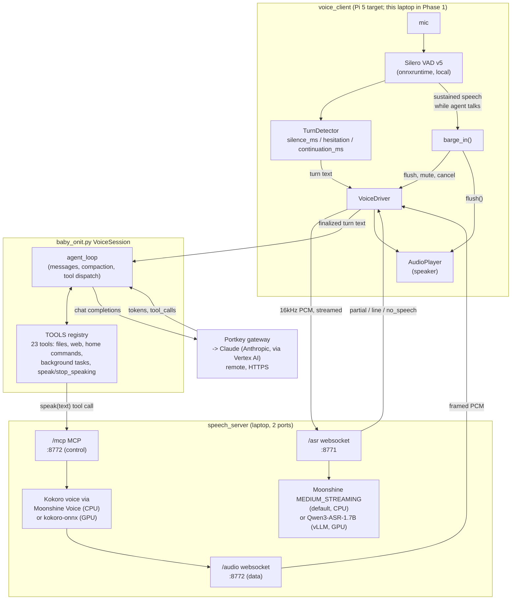

# System details

A reference for how the running system fits together: topology, the exact
prompt the model sees, the full mic→speaker path, how context is managed
turn to turn, and which process serves which component. Each section cites
the source file it was pulled from, since this is meant to stay accurate as
the code changes rather than be a point-in-time description.

## 1. System diagram



## 2. System prompt, verbatim

Two constants in `baby_onit.py`. `SYSTEM_PROMPT` is always sent; `VOICE_PROMPT`
is appended only when `cfg["voice"]` is set (`build_system_prompt()`,
`baby_onit.py:567`).

### `SYSTEM_PROMPT` (`baby_onit.py:499`)

```
You are baby-onit, a helpful AI agent that completes tasks by calling tools.

Working directory: {data_path} (today: {today}). Every file path you write starts here.

Tool routing:
- Files in the working directory: read_file, grep, local_search.
- Public facts, news, current events: web search; fetch pages for details.
- Anything that can change (prices, versions, dates) needs a tool result, never memory. Prefer the primary source over anyone summarizing it.
- Finish with a concise answer; cite the files or URLs you used.

Credentials (pre-wired by the harness; never print, echo, or embed a token):
- GitHub: git clone/pull/push with plain https://github.com/... URLs just works — the harness authenticates git via GIT_ASKPASS. Never hunt for a token or put one in a URL.
- Hugging Face: HF_TOKEN rides in the bash environment for model-hub access. Use `hf download ...` or `huggingface-cli download ...`; a 401 on a gated repo means accept the terms on the model page, then retry.
```

### `VOICE_PROMPT`, appended in voice mode (`baby_onit.py:522`)

```
You are speaking out loud. Everything you write is sent to a speech synthesizer and heard by a person, so:
- Write what a person would say, not what they would read. No markdown, no bullet lists, no tables, no code blocks, no emoji, no URLs read out character by character. Numbers and units in words when that is how you would say them.
- Short sentences. The synthesizer speaks one sentence at a time, so a long clause is a long silence.
- Answer the question first, in one or two sentences. Offer detail only if it was asked for.

Long jobs go to the background. Anything that will take more than a few seconds -- writing an app, a large refactor -- goes to `start_task`, which returns an id at once. Never do a long job in the foreground: the person cannot talk to you while you do, which is the single worst thing you can do to a conversation.
- "Long" includes starting or serving anything: a dev server, a Flask app, a watcher. Those never finish, so running one in the foreground hangs the conversation until the tool times out.
- Call `start_task` once per request. It returns an id; that means the work is under way. Do not call it again for the same job, and do not call it again because you are unsure -- call `check_task` instead.
- After starting one, say so out loud and stop. Do not keep working in the foreground to "help" -- the task is already doing it.
- When asked how it is going, `check_task` and report the step it is on.
- Stop one only when asked, with `cancel_task`.

Speaking is a tool call: `speak`. It returns immediately -- it does not wait for the audio to finish -- so you can keep working while your words play.
- Call `speak` as your FIRST action on any task that will take more than a moment, before any other tool. Silence reads as a broken agent.
- While a long task runs, call `speak` again at each step to say what you are doing now. Keep each one to a sentence.
- Your final answer is spoken too, so end in plain prose.

A voice activity detector is listening the whole time you talk. If the person starts speaking, your speech is cut off mid-sentence and the rest of your reply is discarded. That is normal and expected -- it is not an error, and you should not apologise for it or try to resume where you left off. Treat whatever they said as the next thing to answer, and assume they only heard the part that played before they interrupted.
```

Everything in this second block is *harness-enforced engineering, restated as
instruction* — not the only line of defense. `speak`-first is backed by the
deterministic filler (§3 below); barge-in is backed by the generation counter
in `voice_client/driver.py`, not by the model remembering to behave. The
prompt is reinforcement, not the mechanism.

## 3. The mic-to-speaker path

**Mic → VAD.** `voice_client/capture.py` opens the input device at 16kHz in
512-sample blocks — exactly one Silero v5 frame, so no rebuffering happens
between capture and scoring. Every frame is run through `SileroVad.probability()`
on the capture thread itself (0.08ms measured), not deferred to the event loop,
because barge-in latency is bounded by how fast a frame can be scored.

**VAD → turn boundary.** `TurnDetector` (`voice_client/turn.py`) never
consults ASR text for *when* a turn ends — only the VAD's silence run. ASR
`line` events are not turn boundaries: one utterance can emit several
(measured, see ARCHITECTURE.md §5.1), so dispatching per-line would fire
nonsense turns mid-sentence. The boundary is `silence_ms` (900ms default),
extended by `hesitation_extra_ms` while the live transcript ends in a filler
word (`uhm`, `so`, `I think`, …), and recoverable for `continuation_ms` after
dispatch — if the human resumes before the agent has made a sound, the
dispatched turn is withdrawn and merged into the next one rather than treated
as final.

**Turn text → ASR.** PCM streams continuously to `speech_server`'s
`/asr` websocket. A streaming engine (Moonshine) emits `partial`/`line` events
as it goes; a non-streaming engine (Qwen3-ASR) emits nothing until the client
sends `{"type":"finalize"}` at the VAD boundary, at which point it transcribes
the whole buffered utterance in one call. Either way, the *decision* that the
turn is over is always the client's VAD, never the ASR engine's.

**Turn text → harness.** `VoiceDriver._resolve_turn` waits up to
`transcript_grace_ms` (4000ms) for the text to actually arrive — the VAD
boundary and the ASR's own latency are different events, and reading the
transcript synchronously at the VAD boundary silently dropped utterances when
the ASR hadn't caught up yet (fixed; see ARCHITECTURE.md §5). Once text exists,
`handle_turn` hands it to `VoiceSession.ask()`, which runs `agent_loop`.

**Harness → speaker.** The agent calls `speak` (an MCP tool) the instant it
starts working — enforced by a deterministic local filler spoken *before* the
first LLM token exists, not left to the model to remember. `speak` enqueues
server-side and returns in ~2ms; it never waits for audio. PCM streams back on
a *separate* websocket (`/audio`, not the MCP control channel), framed by
`utterance_id`/`is_final`, straight to `AudioPlayer`.

**Barge-in.** The VAD alone decides this — not ASR, not the LLM. Sustained
speech (`barge_in_ms`, 300ms) while `player.is_playing` is true triggers, in
order: (1) `player.flush()` — local, ~0.05ms; (2) `_audio_muted = True`, so
frames already in flight from the server are dropped rather than refilling the
just-emptied queue; (3) `{"type":"flush"}` sent to the TTS server; (4)
`session.barge_in()`, which cancels the in-flight `agent_loop` task — but
**not** any background task (§4). A generation counter is bumped on every
barge-in; any in-flight work (a queued turn, a resolver waiting on ASR, an
answer about to be spoken) checks it before acting and discards itself if
superseded, rather than surfacing late and out of order.

## 4. Context engineering

**One system message, assembled once per turn.** `build_system_prompt(cfg)`
renders `SYSTEM_PROMPT` (+ `VOICE_PROMPT` in voice mode) with `{data_path}` and
`{today}` substituted — no RAG, no per-tool prompt fragments, no templating
engine. It is `messages[0]` and never mutated mid-loop.

**Fresh by default, replay on request.** `cfg["session_memory"]` defaults to
`False`: `chat` clears `session_history.jsonl` on startup rather than ignoring
it, so a new session never silently inherits an old conversation, and every
turn's `history_budget_tokens` isn't spent on stale context. `chat --resume`
opts back in for one session. `VoiceSession.history` is in-memory only and
never touches disk at all.

**Background tasks get an isolated history.** `start_background()`
(`baby_onit.py`) gives each delegated `agent_loop` its own `history: list`,
never the foreground's. Two conversations never interleave their message
lists, and a worker cannot call `start_task`/`check_task`/`cancel_task` itself
— `cfg["background"]=True` strips those three tools from its own `call_tools`,
closing the recursion a worker delegating to itself would otherwise open.

**Compaction, pre-emptive not reactive** (`agent_loop`, `baby_onit.py:1302`).
Checked at the top of every iteration, *before* the next request is sent —
checking after would always be one iteration stale, since the estimate can't
see tool results appended since the last check. Trigger: estimated tokens
`> 0.85 * max_context_tokens`. On trigger, a second `provider.chat()` call
summarizes everything except the system message into "task, findings, files
touched, what remains"; the transcript is then replaced with that summary plus
a reminder of which tools exist, so the model doesn't need to re-derive what
it already knows is available. `_fit_messages()` is the last-resort hard trim
if compaction alone doesn't fit.

**Replayed history decays, not the live turn.** `build_session_messages()`
keeps the most recent `HISTORY_KEEP_FULL` answers verbatim and truncates older
ones to their opening — a long session degrades gracefully rather than
overflowing, and only applies to *replayed* history (`--resume`), never to the
turn in progress.

**The P5 tool-surface guard is bypassed in voice/background mode.**
Stock baby-onit hides the entire tool surface on iteration 1 unless the task
text matches a keyword list, to stop plain Q&A from over-triggering tool use.
Voice and background turns always see the full tool surface instead — the
guard's premise (a human typing a plain question) doesn't hold when `speak`
itself is a required tool call, and the stock behavior silently answered
`"Set an alarm at 7am"` with zero tools (measured regression, now fixed).

## 5. Components, how served

| Component | Transport | Tools | Model used | Served via | Where |
|---|---|---|---|---|---|
| **ASR** (default) | WebSocket, `ws://host:8771/asr`, binary f32 PCM in / JSON events out | `start`, `reset`, `finalize`, `stop` control messages (VOICE_PROTOCOL.md §1) | Moonshine `MEDIUM_STREAMING` (0.0% WER measured on real speech) | In-process inside `speech_server`, via the `moonshine-voice` Python package | Laptop (CPU) |
| **ASR** (optional) | HTTP, `/v1/audio/transcriptions`, multipart WAV | same control messages; server buffers and POSTs on `finalize` | Qwen3-ASR-1.7B | `vllm.entrypoints.openai.api_server`, separate venv (`.venv-qwen`) | Laptop (GPU, ~5.8GB VRAM) |
| **TTS** (default) | MCP (control) `http://host:8772/mcp` + WebSocket (data) `ws://host:8772/audio` | `speak`, `stop_speaking`, `is_speaking` (MCP tools, exposed to the LLM) | Kokoro voice (`kokoro_af_heart`) via Moonshine Voice | In-process inside `speech_server` | Laptop (CPU, RTF 0.25) or GPU (RTF 0.047) |
| **TTS** (GPU path) | same MCP + WebSocket | same three tools | Kokoro-82M | `kokoro-onnx` on CUDA (`onnxruntime-gpu==1.22.0` pinned) | Laptop (GPU, ~620MB VRAM) |
| **LLM** | HTTPS, OpenAI-compatible `/chat/completions` | the 23-tool `TOOLS` registry (files, web, home commands, `speak`/`stop_speaking`, `start_task`/`check_task`/`cancel_task`) | `claude-sonnet-5` (model id configurable; routed by Portkey's `@integration/model` slug) | Portkey gateway → Claude on Vertex AI | **Remote** — the only non-local component |
| **VAD** | none — a function call, not a service | none; not tool-callable | Silero VAD v5 | `onnxruntime` `InferenceSession`, loaded directly in `voice_client` | Same process as the mic (Pi 5 target; laptop in Phase 1) |
| **Harness** | in-process | owns all of the above as tools/sessions | — (orchestration only) | `baby_onit.VoiceSession` + `voice_client.VoiceDriver`, one Python process | Pi 5 target; laptop in Phase 1 |

Full measured numbers, the structural reason Qwen can't stream, and every
silent-fallback trap hit while building this are in
[ARCHITECTURE.md](ARCHITECTURE.md) — this document is the map, that one is the
evidence.

## 6. Measured latency (slides.pdf metrics table)

**Setup.** Raspberry Pi 5 Model B Rev 1.1, 8 GB RAM, Debian 13 (trixie),
passive cooling (52.1°C idle at measurement time, no throttling). Measured
2026-11-07. The GPU host (Qwen3-ASR + Kokoro TTS, both on an RTX 2000 Ada,
8 GB VRAM) is behind WSL2 NAT, reached via a reverse SSH tunnel onto the Pi's
own loopback — so `127.0.0.1:8771`/`8772` in the numbers below is the real
network path, not a same-host shortcut. LLM: Claude Sonnet 5 via Portkey
(`@gcp-vertexai-us-global-integration/anthropic.claude-sonnet-5`) → Vertex AI,
over the open internet from the Pi.

**Method.** One clock (the Pi's `time.monotonic()`), matching the slide's own
methodology. `scripts/bench_latency.py` (run from the Pi) exercises the real
deployed stack end-to-end — same `speech_server` over the same tunnel, same
`VoiceSession`/`baby_onit.dispatch("speak", ...)` call path production uses,
not a synthetic stand-in:

- **ASR final** (`end of speech → transcript`): opens the real `/asr`
  websocket, streams two pre-recorded 16 kHz mono WAVs (`mytest.wav`,
  `recording.wav`, 6 s each) frame-by-frame, times from the `finalize` send
  (the client-side VAD-boundary equivalent) to the `line`/`no_speech` reply.
  5 runs × 2 files = 10 trials.
- **LLM TTFT** (`transcript → first token`): a fixed short prompt run through
  the real `VoiceSession.ask()` → `agent_loop`; TTFT is read off the
  `on_event("usage", ...)` the loop already emits (`model_s - decode_s`,
  `baby_onit.py:1370-1382`) rather than added instrumentation. 5 runs.
- **TTS TTFB** (`speak() call → first audio chunk`): times
  `baby_onit.dispatch("speak", {"text": answer})` against a `/audio`
  websocket opened *before* the call, matched by `utterance_id` on the first
  frame. Same 5 runs, chained after the LLM call above.
- **E2E** (`end of speech → audio out`): composed as ASR-final + the
  transcript-to-audio leg (LLM TTFT through TTS TTFB) — the slide's own
  chained definition — from the cross product of the two independently
  measured legs (50 pairs), not 1:1 paired runs, since ASR has no dependency
  on which transcript the LLM leg happened to receive.

Raw per-run JSON: [`bench_results_2026-11-07.json`](bench_results_2026-11-07.json).

| Metric | Definition | Mean | p95 | n |
|---|---|---|---|---|
| **E2E latency** | end of speech → audio out | **2122 ms** | **4060 ms** | 50 (composed) |
| **ASR final** | end of speech → transcript | **440 ms** | **747 ms** | 10 |
| **LLM TTFT** | transcript → first token | **1431 ms** | **3129 ms** | 5 |
| **TTS TTFB** | `speak()` call → first audio chunk | **218 ms** | **323 ms** | 5 |
| **Barge-in** | speech → playback stopped | **~300 ms** | — | see note |

Notes on the numbers themselves:

- **ASR final has two distinct clusters** (`mytest.wav`: 192–497 ms;
  `recording.wav`: 557–747 ms) — content-dependent decode time on Qwen3-ASR's
  autoregressive decoder, not noise; this is exactly why n=10 across two
  different recordings was used rather than one file repeated.
- **LLM TTFT's p95 is a single cold-start outlier** (run 0: 3129 ms vs.
  849–1151 ms for runs 1-4) — first-call client/connection setup to Portkey,
  not steady-state. Steady-state mean across runs 1-4 alone: ~1006 ms.
- **Barge-in** is **not** re-measured here: this Pi's mic (USB) and speaker
  (Bluetooth) are acoustically separate devices in the same room with no AEC
  implemented in this codebase (see the acoustic-echo self-interruption issue
  worked around during bringup), making a live acoustic barge-in test
  unreliable right now. The number above is composed from existing,
  already-verified measurements instead: the client requires `barge_in_ms`
  (300 ms, `voice_client/config.py:40`) of *sustained* VAD-positive speech
  before honoring a barge-in — that threshold dominates — plus
  `player.flush()` and `cancel_stream()`, both measured at effectively 0 ms
  (ARCHITECTURE.md, TTS table, "`cancel_stream()` **0.0 ms**"). Total is the
  threshold itself, ~300 ms, not a new measurement.

### 6.1 Which of these are network-bound?

Measured the floor for each hop directly, rather than guessing:

| Hop | Measured floor | vs. measured stage latency |
|---|---|---|
| Pi → tunnel → `speech_server` (ASR/TTS) | TCP connect ~0.1 ms, full HTTP round trip ~6-10 ms | ASR 200-750 ms, TTS TTFB 218 ms mean — floor is **negligible** |
| Pi → internet → Portkey (LLM) | TLS handshake ~10-35 ms warm; time-to-first-byte on a trivial request **0.31 s / 1.07 s / 2.28 s** across three back-to-back calls | LLM TTFT 849-3129 ms — same variance pattern, same order of magnitude |

**ASR final and TTS TTFB are compute-bound, not network-bound.** The
tunnel's own round trip is 2-3 orders of magnitude smaller than either stage's
measured latency — Qwen3-ASR's decode time and Kokoro's GPU synthesis time
dominate, and the WSL2-NAT reverse-tunnel hop this deployment depends on
(see [rpi_app/README.md](../rpi_app/README.md)) costs essentially nothing extra.

**LLM TTFT is partly network/gateway-bound.** Portkey's own time-to-first-byte
on a request with *no* model computation in it (a bare `GET /v1`) varied by
**7x** across three calls with no change on this end. That variance lines up
almost exactly with the LLM TTFT spread (849-3129 ms) and explains the run-0
cold-start outlier directly: the `openai` client's first request pays full
DNS + TCP connect + TLS + Portkey-routing cost, and later requests on the
same connection land in the cheaper ~850-1150 ms band. This means a
meaningful share of LLM TTFT — and nearly all of its p95 — is Portkey/network
variability, not Claude's own token-generation time.

**E2E inherits that network sensitivity** through its LLM leg, the largest
single component of the composed total.

**Barge-in has no network dependency at all.** VAD detection, `player.flush()`,
and the generation-counter cancellation are entirely local to the Pi — the
~300 ms figure is a configured sustained-speech threshold (`barge_in_ms`),
not a round trip to anything.
